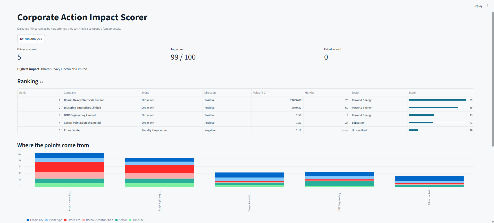
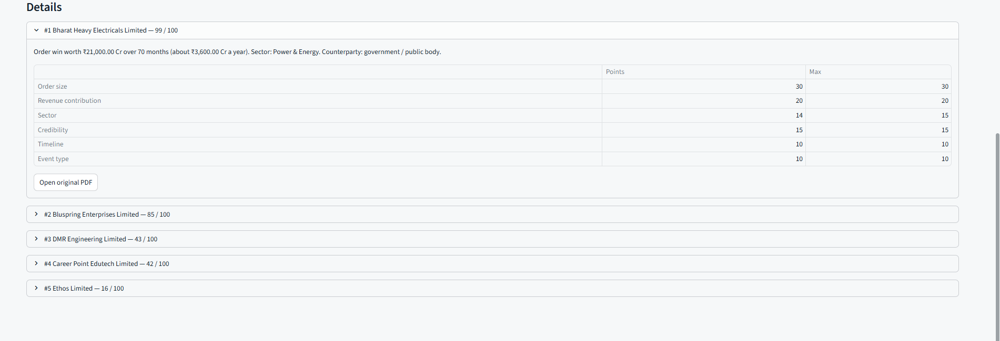

# Corporate Action Impact Scorer

Reads exchange filings (PDF), extracts the key facts, scores each one out of 100, ranks them, and shows the result in a dashboard.

## How it works

```
PDF link -> download -> text (pdfplumber) -> facts (rules) -> score -> rank -> dashboard
```

| File | Job |
|---|---|
| `extract.py` | Download PDF, read text, pull out company, event type, value, sector, timeline |
| `scoring.py` | All weights and the scoring rules. Change numbers here |
| `main.py` | Runs the pipeline for the 5 links. `python main.py` prints the ranking |
| `app.py` | Streamlit dashboard |
| `test_impact.py` | Offline checks for extraction and ranking |

### Extracted facts

- **Company**: from the signature line ("For ... Limited").
- **Event type**: keyword hits per type (order win, penalty, acquisition, fund raise...). The type with most hits wins.
- **Value**: largest rupee amount, converted to ₹ crore (handles Rs., ₹, Cr, Crores, lakh, million, plain rupees).
- **Timeline**: first "N months/years" phrase ("two years" works too).
- **Sector**: keyword hits per sector.
- **Counterparty**: government or public body keywords.

### Score (100 points)

| Factor | Max | Rule |
|---|---|---|
| Order size | 30 | Value in ₹ Cr, in tiers (≥10,000 Cr gets 30, ≥1 Cr gets 4) |
| Revenue contribution | 20 | Value per year (value / years). No duration = one-off |
| Sector | 15 | Defence 15, Power 14, Infrastructure 13 ... Unspecified 6 |
| Credibility | 15 | 10 if government / public body, else 6. Plus 5 if a value is stated |
| Timeline | 10 | Longer contract = more visible earnings (≥60 months gets 10) |
| Event type | 10 | Order win 10, Penalty 5, Other 2 |

If the company says there is **no material impact**, the total is halved.

The score measures **how big** the news is. The **Direction** column (Positive / Negative / Neutral) shows which way.

## Setup

Python 3.9+.

```bash
pip install -r requirements.txt
python main.py          # ranking in the terminal
streamlit run app.py    # dashboard at http://localhost:8501
python test_impact.py   # checks
```

## If a PDF will not download

NSE and BSE sometimes block scripts. Open the link in a browser, save the file **with the same name as in the URL** into `pdfs/`, and run again. The app uses files in `pdfs/` before it tries to download.

## Example output

```
1. Bharat Heavy Electricals Limited | Order win | score 99/100
2. Bluspring Enterprises Limited | Order win | score 85/100
3. Career Point Edutech Limited | Order win | score 42/100
4. Ethos Limited | Penalty / legal order | score 16/100
```

## Limits

- Extraction is rule based. A filing with unusual wording may give a wrong type or sector. Add keywords in `extract.py`.
- Scores use absolute rupee size. Company size (market cap) is not used.
- Scanned PDFs without a text layer are rejected with a clear error.

## Screenshots



